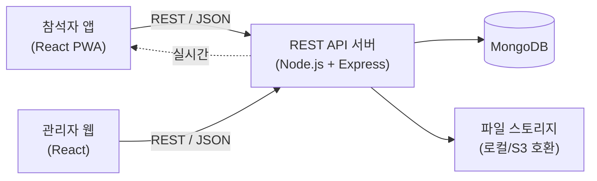

# 워크샵 참석자 전용 앱 — 작업지시서

| 항목 | 내용 |
|---|---|
| 문서 버전 | v1.0 (초안) |
| 작성일 | 2026-10-15 |
| 프로젝트명 | 워크샵 관리 앱 (참석자 앱 + 관리자 웹/REST API) |

---

## 1. 프로젝트 개요

### 1.1 목적
워크샵 **참석자**가 스마트폰 앱으로 참석 체크 → 정보/아젠다/미션 확인 → 조별·개인 작업물 업로드 → 결과물 공유·투표·피드백 → 순위 및 우승 축하 알림까지 **워크샵 전 과정을 한 앱에서** 수행하도록 한다. 운영자는 관리자 웹에서 워크샵·조·미션을 설정하고 진행 현황을 모니터링한다.

### 1.2 사용자
| 구분 | 설명 | 사용 채널 |
|---|---|---|
| 참석자 (주 사용자) | 워크샵을 요청한 기업사 직원(클라이언트), 워크샵에 참석한 일반 소비자 | 스마트폰 앱 |
| 관리자 | 워크샵 운영/진행 담당자 | 관리자 웹 |

### 1.3 UX 방향
- **토스(Toss) 앱 UI 느낌**: 큰 타이포그래피, 한 화면 한 가지 목적, 카드형 레이아웃, 하단 고정 CTA 버튼, 여백이 넉넉한 단순한 화면, 부드러운 전환 애니메이션, 성공/완료 연출.
- **카카오톡 앱 방식**: 하단 탭 네비게이션, 알림 중심 인터랙션(푸시/인앱 알림 뱃지), 채팅 같은 가벼운 입력(피드백 메모), 이미지/파일 전송 UX(업로드 시 미리보기·진행률).

### 1.4 해석/가정 사항 (원문 오탈자 보정)
| 원문 | 해석 |
|---|---|
| 워크샵 정보 "멫" 아젠다 | 워크샵 정보 **및** 아젠다 |
| 워크샵 "미샨" 확인 | 워크샵 **미션** 확인 |
| 스마트폰 앱 (reactjs) | React 기반 **모바일 웹앱(PWA)** 으로 개발. 필요 시 Capacitor로 네이티브 래핑(스토어 배포) 가능 |

---

## 2. 기능 범위

### 2.1 참석자 앱 기능 (F-xx)

| ID | 기능 | 상세 | 우선순위 |
|---|---|---|---|
| F-01 | 입장/인증 | 초대 링크·워크샵 코드·QR 중 택1로 진입, 이름+전화번호(또는 사전 등록 정보) 확인. 별도 회원가입 없음 | P0 |
| F-02 | 참석 확인 | 현장 QR 스캔/코드 입력으로 체크인, 체크인 시각 기록, 완료 연출 | P0 |
| F-03 | 워크샵 정보 | 일시, 장소, 주최, 공지, 준비물, 조 편성 안내 | P0 |
| F-04 | 아젠다 | 타임라인형 일정, 현재 진행 세션 강조 | P0 |
| F-05 | 워크샵 미션 | 미션 목록/상세(설명, 유형: 조별/개인, 제출 형식, 마감시간, 상태) | P0 |
| F-06 | 작업물 업로드 | 조별/개인 작업물 업로드(이미지, 문서, 영상, 링크, 텍스트), 미리보기, 진행률, 재업로드/삭제 | P0 |
| F-07 | 업로드 상태 대시보드 | 조별·개인 제출 현황(제출/미제출/마감), 진행률 바, 실시간 갱신 | P0 |
| F-08 | 결과물 같이보기 | 전체 조/개인 결과물 갤러리, 필터(미션/조), 상세 뷰어 | P0 |
| F-09 | 선호도 투표 | 조별 결과물에 대한 선호도 투표(규칙 5.4 참조), 투표 후 수정 가능 여부는 운영 설정 | P0 |
| F-10 | 피드백 메모 | 결과물별 짧은 피드백 메모 작성/수정/삭제(카톡식 입력창) | P1 |
| F-11 | 선호도 순위 | 조별 투표 결과 순위(공개 시점은 관리자 제어), 득표수/비율 | P0 |
| F-12 | 축하 알림 | 우승팀/최고 작업자 선정 시 전체 참석자에게 축하 알림 + 축하 화면(컨페티 연출) | P0 |
| F-13 | 알림함 | 인앱 알림 목록, 읽음 처리, 미확인 뱃지 | P1 |

### 2.2 관리자 웹 기능 (A-xx)
| ID | 기능 | 상세 | 우선순위 |
|---|---|---|---|
| A-01 | 관리자 로그인 | 이메일/비밀번호, JWT | P0 |
| A-02 | 워크샵 관리 | 워크샵 CRUD, 상태(준비/진행/종료), 코드·QR 발급 | P0 |
| A-03 | 아젠다/미션 관리 | 아젠다 항목, 미션 CRUD, 마감시간 | P0 |
| A-04 | 참석자/조 관리 | 참석자 사전등록(CSV 업로드), 조 편성(수동/랜덤), 참석 현황 | P0 |
| A-05 | 제출 현황 모니터링 | 조별/개인 제출 대시보드, 작업물 열람/삭제(부적절 콘텐츠) | P0 |
| A-06 | 투표 운영 | 투표 시작/종료, 순위 공개 제어 | P0 |
| A-07 | 우승 선정/알림 발송 | 우승팀 자동 산출(득표), **최고 작업자 선정**(관리자 지정 또는 개인 투표 기반), 축하 알림 발송 | P0 |
| A-08 | 공지/알림 발송 | 전체/조별 공지 | P1 |
| A-09 | 결과 리포트 | 참석률, 제출률, 투표 결과 CSV 내보내기 | P2 |

### 2.3 범위 제외 (현 단계)
- 결제, 외부 SNS 로그인, 네이티브 스토어 배포(후속 옵션), 다국어.

---

## 3. 시스템 아키텍처



### 3.1 기술 스택
| 영역 | 선택 | 비고 |
|---|---|---|
| 참석자 앱 | React 18 + Vite + TypeScript, React Router, TanStack Query, PWA(vite-plugin-pwa) | 모바일 우선(max-width 480px 기준) |
| 관리자 웹 | React 18 + Vite + TypeScript, 관리자용 UI 라이브러리(예: Ant Design 또는 MUI) | 앱과 **별도 프로젝트** |
| API 서버 | Node.js + Express + TypeScript, Mongoose, Zod(검증), JWT, Multer(업로드) | REST API, `/api/v1` 프리픽스 |
| DB | MongoDB (Mongoose ODM) | |
| 실시간/알림 | SSE(Server-Sent Events) 기본, Web Push(선택) | 대시보드 갱신, 축하 알림 |
| 테스트 | **Playwright** (E2E + API 테스트) | |
| 설정 | **`.env`** 로 환경변수 관리 | 8장 참조 |

> 앱과 관리자 웹은 **서로 독립 빌드/배포**하며, 모든 데이터 연동은 REST API로만 수행한다.

### 3.2 저장소 구조 (모노레포 제안)
```
워크샵관리앱/
├─ apps/
│  ├─ mobile/          # 참석자 앱 (React PWA)
│  ├─ admin/           # 관리자 웹 (React)
│  └─ api/             # REST API 서버
├─ packages/
│  └─ shared/          # 공용 타입/상수 (선택)
├─ tests/              # Playwright 테스트
├─ .env.example
├─ playwright.config.ts
├─ package.json        # npm/pnpm workspaces
└─ 작업지시서.md
```

---

## 4. 데이터 모델 (MongoDB 컬렉션)

| 컬렉션 | 주요 필드 |
|---|---|
| `admins` | email, passwordHash, name, role, createdAt |
| `workshops` | title, description, organizerCompany, location, startAt, endAt, status(`ready`/`live`/`closed`), joinCode, notice, resultsPublic(bool), votingStatus(`before`/`open`/`closed`) |
| `agendas` | workshopId, order, title, description, startAt, endAt |
| `teams` | workshopId, name, color, memberIds[] |
| `participants` | workshopId, name, phone, company, type(`client`/`consumer`), teamId, checkedInAt, status, tokenVersion |
| `missions` | workshopId, title, description, scope(`team`/`individual`), submitTypes[], dueAt, order |
| `submissions` | workshopId, missionId, scope, teamId?, participantId, title, comment, files[{url,mime,size,name}], links[], status(`draft`/`submitted`), submittedAt, version |
| `votes` | workshopId, missionId, voterId, submissionId(or teamId), createdAt — **unique(voterId, missionId)** (규칙에 따라 조정) |
| `feedbacks` | workshopId, submissionId, authorId, content, createdAt, updatedAt |
| `awards` | workshopId, type(`winningTeam`/`topWorker`), teamId?, participantId?, reason, announcedAt |
| `notifications` | workshopId, targetType(`all`/`team`/`participant`), targetId?, type(`award`/`notice`/`mission`), title, body, createdAt |
| `notificationReads` | notificationId, participantId, readAt |

**인덱스**: `participants(workshopId, phone)` unique, `workshops.joinCode` unique, `votes(voterId, missionId)` unique, `submissions(workshopId, missionId, teamId)`, `feedbacks(submissionId)`.

---

## 5. 핵심 비즈니스 규칙

### 5.1 인증
- 참석자: 워크샵 코드 + 이름 + 전화번호(관리자 사전 등록 명단과 일치) → 참석자용 JWT 발급(만료: 워크샵 종료+1일).
- 관리자: 이메일/비밀번호 → JWT(Access) + Refresh.

### 5.2 참석 체크
- 워크샵 `live` 상태 또는 시작 N분 전부터 체크인 가능. 중복 체크인은 최초 시각 유지.

### 5.3 작업물 제출
- 조별 미션: 조원 누구나 제출/수정 가능(조당 1개 제출물, 버전 이력 유지). 개인 미션: 본인 1건.
- 마감 후 제출 차단(관리자 예외 허용 옵션).
- 파일 제한: 이미지(jpg/png/webp/gif), 문서(pdf/pptx/docx), 영상(mp4), 파일당 최대 `UPLOAD_MAX_SIZE_MB`.
- 제출 상태 값: `미제출` / `작성중(draft)` / `제출완료` / `마감(미제출)`.

### 5.4 투표(선호도)
- 투표 대상: **조별 결과물**(미션별). 투표는 `votingStatus = open` 일 때만.
- **자기 조에는 투표 불가**, 1인 미션당 1표(기본값, 관리자 설정으로 N표 확장 가능).
- 투표 마감 전 변경 허용(마지막 표 유효).
- 투표 중에는 **실시간 득표수 비공개**, 관리자가 공개할 때 순위 노출.

### 5.5 순위/우승/최고 작업자
- 조 순위 = 득표수 내림차순, 동률 시 최초 도달 시각이 빠른 조 우선(또는 공동 순위 — 확인 필요).
- 우승팀 = 1위 조(복수 미션 시 합산 또는 지정 미션 기준 — 관리자 설정).
- 최고 작업자 = 관리자 지정 또는 개인 미션 투표 1위(확인 필요, 11장).
- 선정 확정 시 `awards` 저장 + 전체 참석자 알림 생성 + 실시간 푸시.

### 5.6 알림
- 유형: 공지, 미션 오픈/마감 임박, 투표 시작, 순위 공개, **우승팀/최고 작업자 축하**.
- 전달: 앱 내 알림함 + 앱 열려있을 때 SSE 토스트 + (선택) Web Push.

---

## 6. 화면 설계 (참석자 앱)

### 6.1 하단 탭(카카오톡 방식)
`홈` · `미션` · `결과물` · `투표/순위` · `알림`

### 6.2 화면 목록
| 화면 ID | 화면 | 주요 요소 |
|---|---|---|
| S-01 | 입장 | 워크샵 코드 입력/QR 스캔, 이름·전화번호 |
| S-02 | 참석 체크인 | QR 스캔/코드 입력, 완료 체크 애니메이션 |
| S-03 | 홈 | 인사말, 워크샵 요약 카드, 현재 진행 아젠다, 내 미션 현황 카드, 공지 |
| S-04 | 워크샵 정보 | 일시/장소/조 편성/준비물 |
| S-05 | 아젠다 | 세로 타임라인, 진행중 강조 |
| S-06 | 미션 목록/상세 | 미션 카드, 마감 카운트다운, 상태 뱃지 |
| S-07 | 작업물 업로드 | 파일 선택/촬영, 미리보기, 진행률, 하단 고정 "제출하기" 버튼 |
| S-08 | 제출 현황 대시보드 | 조별 진행률, 개인 제출 여부, 전체 제출률 도넛/바 |
| S-09 | 결과물 갤러리/상세 | 그리드, 필터, 상세 뷰어(스와이프), 피드백 메모 입력창 |
| S-10 | 투표 | 후보 카드 선택 → 확인 바텀시트 → 완료 |
| S-11 | 순위 | 1~N위 리스트(1위 강조), 득표수/비율 |
| S-12 | 축하 화면 | 컨페티, 우승팀/최고 작업자 소개, 공유 |
| S-13 | 알림함 | 읽음/안읽음, 알림 유형 아이콘 |

### 6.3 UI 가이드라인
- 한 화면 한 목적, 핵심 CTA는 하단 고정 풀폭 버튼(둥근 모서리 12~16px).
- 색상: 메인 블루 계열(토스 느낌) + 중립 그레이, 상태색(성공/경고/오류) 명확 구분.
- 타이포: 큰 헤드라인(24~28px bold), 본문 15~16px, 터치 영역 최소 44px.
- 로딩은 스켈레톤, 빈 상태/오류 상태 일러스트·문구 필수, 완료 시 마이크로 인터랙션.
- 접근성: 대비비 4.5:1 이상, `aria-label`, 키보드 포커스 표시.

---

## 7. REST API 명세 (요약)

공통: Base `/api/v1`, 응답 `{ success, data, error }`, 인증 `Authorization: Bearer <token>`.

### 7.1 참석자 API
| Method | Endpoint | 설명 |
|---|---|---|
| POST | `/auth/participant/login` | 코드+이름+전화번호 로그인 |
| POST | `/workshops/:id/checkin` | 참석 체크인 |
| GET | `/workshops/:id` | 워크샵 정보 |
| GET | `/workshops/:id/agendas` | 아젠다 |
| GET | `/workshops/:id/missions` | 미션 목록(내 제출 상태 포함) |
| GET | `/missions/:id` | 미션 상세 |
| POST | `/missions/:id/submissions` | 작업물 제출(multipart) |
| PUT | `/submissions/:id` | 작업물 수정 |
| DELETE | `/submissions/:id` | 작업물 삭제(마감 전) |
| GET | `/workshops/:id/dashboard` | 제출 현황 |
| GET | `/missions/:id/submissions` | 결과물 목록(같이보기) |
| GET | `/submissions/:id` | 결과물 상세 |
| POST | `/missions/:id/votes` | 투표/변경 |
| GET | `/missions/:id/votes/me` | 내 투표 조회 |
| GET | `/missions/:id/ranking` | 순위(공개 시) |
| GET/POST/PUT/DELETE | `/submissions/:id/feedbacks` | 피드백 메모 |
| GET | `/workshops/:id/awards` | 우승/최고 작업자 |
| GET | `/notifications` | 알림 목록 |
| POST | `/notifications/:id/read` | 읽음 처리 |
| GET | `/workshops/:id/stream` | SSE 실시간 이벤트 |

### 7.2 관리자 API (`/admin/...`)
| Method | Endpoint | 설명 |
|---|---|---|
| POST | `/admin/auth/login` | 관리자 로그인 |
| CRUD | `/admin/workshops`, `/admin/workshops/:id/agendas`, `/admin/workshops/:id/missions` | 워크샵/아젠다/미션 |
| CRUD | `/admin/workshops/:id/participants`, `POST .../participants/import` | 참석자 + CSV 일괄 등록 |
| CRUD | `/admin/workshops/:id/teams`, `POST .../teams/auto-assign` | 조 편성 |
| GET | `/admin/workshops/:id/dashboard` | 제출/참석 현황 |
| POST | `/admin/missions/:id/voting/open` · `/close` | 투표 시작/종료 |
| POST | `/admin/missions/:id/ranking/publish` | 순위 공개 |
| POST | `/admin/workshops/:id/awards` | 우승팀/최고 작업자 확정 + 알림 발송 |
| POST | `/admin/notifications` | 공지/알림 발송 |
| GET | `/admin/workshops/:id/report.csv` | 결과 리포트 |

---

## 8. 환경 변수 (`.env`) 관리

모든 주요 설정은 `.env` 로 관리하며, **`.env` 는 `.gitignore` 처리, `.env.example` 만 커밋**한다. 코드 내 하드코딩 금지, 서버 기동 시 Zod로 필수값 검증 후 누락 시 즉시 종료한다.

```dotenv
# ===== 공통 =====
NODE_ENV=development

# ===== API 서버 =====
API_PORT=4000
API_BASE_URL=http://localhost:4000
CORS_ORIGINS=http://localhost:5173,http://localhost:5174

# ===== MongoDB =====
MONGODB_URI=mongodb://localhost:27017/workshop_app
MONGODB_DB_NAME=workshop_app

# ===== 인증 =====
JWT_SECRET=change-me
JWT_ACCESS_EXPIRES_IN=2h
JWT_REFRESH_EXPIRES_IN=14d
PARTICIPANT_TOKEN_EXPIRES_IN=3d

# ===== 파일 업로드 =====
UPLOAD_DIR=./uploads
UPLOAD_MAX_SIZE_MB=50
UPLOAD_ALLOWED_MIME=image/jpeg,image/png,image/webp,image/gif,application/pdf,video/mp4

# ===== 푸시 알림(선택) =====
VAPID_PUBLIC_KEY=
VAPID_PRIVATE_KEY=

# ===== 프론트(Vite: VITE_ 접두사) =====
VITE_API_BASE_URL=http://localhost:4000/api/v1
VITE_APP_NAME=워크샵 앱

# ===== 시드/테스트 =====
ADMIN_SEED_EMAIL=admin@example.com
ADMIN_SEED_PASSWORD=change-me
E2E_MOBILE_URL=http://localhost:5173
E2E_ADMIN_URL=http://localhost:5174
E2E_API_URL=http://localhost:4000
MONGODB_URI_TEST=mongodb://localhost:27017/workshop_app_test
```

> 프론트엔드(`VITE_*`)에는 비밀값을 절대 넣지 않는다. 앱/관리자/API는 각자 `.env`를 갖고 `.env.example`을 제공한다.

---

## 9. 비기능 요구사항
| 구분 | 요구사항 |
|---|---|
| 성능 | 주요 화면 LCP 2.5초 이내(4G), 이미지 업로드 시 클라이언트 리사이즈/압축, 목록 페이지네이션/무한스크롤 |
| 동시성 | 워크샵당 동시 접속 최소 300명 가정(확인 필요), 투표 중복 방지는 DB unique 인덱스로 보장 |
| 보안 | 비밀번호 bcrypt, JWT, 입력 검증(Zod), 업로드 MIME/크기 검증, rate limit, helmet, CORS 화이트리스트, 개인정보(전화번호) 마스킹/최소 수집 |
| 호환성 | iOS Safari 15+, Android Chrome 최신, 관리자 웹은 데스크톱 Chrome/Edge/Safari |
| 가용성 | 업로드 실패 시 재시도 UX, 네트워크 오류 시 안내 |
| 로그 | 요청 로그, 에러 로그, 관리자 주요 행위 감사 로그 |

---

## 10. 테스트 계획 (Playwright)

### 10.1 구성
- `playwright.config.ts`: 프로젝트 `mobile`(iPhone 13 / Pixel 7 디바이스 에뮬레이션), `admin`(Desktop Chrome), `api`(request 컨텍스트).
- 테스트용 DB(`MONGODB_URI_TEST`)와 시드 스크립트 사용, `webServer` 옵션으로 API/앱/관리자 자동 기동.
- URL/계정은 `.env`(`E2E_*`) 에서 주입.

### 10.2 시나리오
| ID | 구분 | 시나리오 |
|---|---|---|
| T-01 | E2E(모바일) | 코드+이름+전화번호 입장 → 체크인 완료 |
| T-02 | E2E(모바일) | 홈에서 워크샵 정보/아젠다 확인 |
| T-03 | E2E(모바일) | 미션 상세 확인 → 이미지 업로드 → 제출 완료 상태 반영 |
| T-04 | E2E(모바일) | 마감 후 업로드 차단 |
| T-05 | E2E(모바일) | 제출 현황 대시보드 수치 일치 |
| T-06 | E2E(모바일) | 결과물 갤러리 열람, 피드백 메모 등록/수정/삭제 |
| T-07 | E2E(모바일) | 투표 성공, **자기 조 투표 불가**, 중복 투표 방지/변경 |
| T-08 | E2E(멀티 컨텍스트) | 관리자가 순위 공개 → 참석자 앱에서 순위 노출 |
| T-09 | E2E(멀티 컨텍스트) | 관리자가 우승팀/최고 작업자 확정 → 참석자 앱에 축하 알림/화면 즉시 표시 |
| T-10 | E2E(관리자) | 워크샵/미션/참석자(CSV)/조 편성 CRUD |
| T-11 | API | 인증/권한(타 워크샵 접근 차단, 참석자의 관리자 API 접근 403) |
| T-12 | API | 업로드 제한(용량/MIME), 투표 규칙, 입력 검증 오류 |
| T-13 | 시각/반응형 | 주요 화면 스크린샷 비교(모바일 뷰포트) |

### 10.3 실행
`npx playwright test` (CI에서 headless, 실패 시 trace/screenshot/video 보존)

---

## 11. 확인 필요 사항 (진행 전 결정 요청)

| # | 질문 | 기본 가정 |
|---|---|---|
| Q1 | 앱 배포 형태: PWA(웹앱) vs 스토어 배포(네이티브 래핑, React Native 등) | PWA |
| Q2 | 참석자 인증 방식: 사전 명단 기반 vs 자유 입력 | 사전 명단 + 워크샵 코드 |
| Q3 | 최고 작업자 선정 기준: 관리자 지정 / 개인 투표 / 둘 다 | 관리자 지정(개인 투표 옵션) |
| Q4 | 투표 방식: 1인 1표 vs 복수 표 / 미션별 투표 vs 전체 1회 | 미션별 1인 1표, 자기 조 제외 |
| Q5 | 순위 동률 처리 | 공동 순위 |
| Q6 | 푸시 알림(앱 종료 상태) 필요 여부 | 인앱 + SSE, Web Push 선택 |
| Q7 | 동시 접속 규모 및 파일(영상) 용량 | 300명 / 파일당 50MB |
| Q8 | 파일 저장소: 로컬 vs 클라우드(S3 등) | 로컬(어댑터로 교체 가능) |
| Q9 | 클라이언트 기업별 브랜딩(로고/컬러) 필요 여부 | 불필요 |
| Q10 | 워크샵 종료 후 데이터 보관/결과물 열람 기간 | 종료 후 30일 |

---

## 12. 작업 단계 및 체크리스트

### Phase 0. 프로젝트 셋업 (0.5주)
- [ ] 모노레포 구성(apps/mobile, apps/admin, apps/api), TypeScript/ESLint/Prettier
- [ ] `.env.example` 작성, `.gitignore`에 `.env` 등록, 환경변수 검증 모듈
- [ ] MongoDB 연결, 시드 스크립트(관리자/샘플 워크샵)
- [ ] Playwright 초기 설정, CI 스크립트

### Phase 1. API 코어 (1주)
- [ ] 스키마/인덱스(4장), 공통 응답/에러 처리/검증 미들웨어
- [ ] 인증(참석자/관리자 JWT), 권한 미들웨어
- [ ] 워크샵·아젠다·미션·참석자·조 CRUD, CSV 임포트
- [ ] 체크인 API

### Phase 2. 참석자 앱 — 기본 (1주)
- [ ] 디자인 시스템(토스풍 컴포넌트: 버튼, 카드, 바텀시트, 스켈레톤, 토스트)
- [ ] 하단 탭 레이아웃, 라우팅, 인증 흐름
- [ ] S-01~S-06 (입장, 체크인, 홈, 정보, 아젠다, 미션)

### Phase 3. 업로드/대시보드/갤러리 (1주)
- [ ] 업로드 API(multipart, 검증) + S-07 UI(미리보기/진행률)
- [ ] 제출 현황 API/S-08, 실시간(SSE) 갱신
- [ ] 결과물 갤러리/상세 S-09, 피드백 메모 API/UI

### Phase 4. 투표/순위/축하 (1주)
- [ ] 투표 API(규칙 5.4) + S-10
- [ ] 순위 계산/공개 API + S-11
- [ ] 우승/최고 작업자 확정, 알림 생성/SSE 전송, S-12 축하 화면, S-13 알림함

### Phase 5. 관리자 웹 (1주, Phase 3~4와 병행 가능)
- [ ] 로그인, 워크샵/아젠다/미션 관리
- [ ] 참석자/조 관리, 참석·제출 현황 대시보드
- [ ] 투표 운영, 순위 공개, 우승 선정/알림 발송, 공지

### Phase 6. 테스트/안정화 (1주)
- [ ] Playwright 시나리오 T-01~T-13 구현 및 통과
- [ ] 성능/보안 점검, 모바일 실기기 점검(iOS/Android)
- [ ] 버그 수정, 문서화(README, API 문서, 운영 가이드)

**총 예상 기간: 약 5~6주** (1~2인 기준, 확인 필요 사항에 따라 변동)

---

## 13. 완료 기준 (Definition of Done)
- [ ] F-01~F-13 / A-01~A-08 의 P0·P1 기능이 동작한다.
- [ ] Playwright 테스트 T-01~T-13 이 모두 통과한다.
- [ ] 모든 주요 설정이 `.env` 로 관리되며 코드에 비밀값/URL 하드코딩이 없다.
- [ ] 참석자 앱과 관리자 웹이 분리 배포되고 REST API로만 통신한다.
- [ ] 모바일(iOS Safari/Android Chrome)에서 토스풍 UI·카카오톡식 탭/알림 흐름이 일관되게 동작한다.
- [ ] 투표 중복/자기 조 투표/마감 후 제출이 서버에서 차단된다.
- [ ] `.env.example`, README(실행 방법), API 문서가 제공된다.
